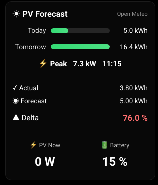

# MMM-PVForecast



PV forecast and Fronius integration module for MagicMirror².

MMM-PVForecast combines multiple forecast providers with live data from a Fronius GEN24 inverter and automatically handles provider outages, rate limits and cached fallback data.

---

## Features

### Forecast Providers

Supported forecast services:

- Open-Meteo
- Solcast
- Forecast.Solar

Select the preferred provider using:

```js
provider: "openmeteo"
```

or

```js
provider: "solcast"
```

or

```js
provider: "forecastsolar"
```

---

### Automatic Provider Failover

If the preferred forecast source becomes unavailable, the module automatically falls back to alternative providers.

Examples:

```text
Open-Meteo
↓
Solcast
↓
Forecast.Solar
↓
Cached Forecast Data
```

The display continues to work even if one provider becomes temporarily unavailable or reaches its API limits.

---

### Fronius GEN24 Integration

Supported values:

- Current PV power
- Battery state of charge (SOC)
- Daily production
- Expected yield
- Actual yield
- Delta comparison (Actual / Expected)

---

### Smart Caching

Caches are automatically refreshed and reused whenever possible.

---

### Persistent Rate-Limit Protection

When a provider reaches its API limit, the block information is stored on disk and survives restarts.

Open-Meteo does not require API keys and therefore does not require rate-limit protection files.

---

### Active Hours

To reduce API usage, forecast updates can be limited to a configurable time window.

Example:

```js
activeHours: {
    start: "07:00",
    end: "21:00"
}
```

Outside this window:

- No forecast API requests are sent
- Cached data remains available
- Fronius live values continue to update

Disable the feature completely:

```js
activeHours: false
```

---

## Installation

```bash
cd ~/MagicMirror/modules

git clone https://github.com/ChrisF1976/MMM-PVForecast.git

cd MMM-PVForecast

npm install
```
---

### Open-Meteo Installation (Optional)

The Open-Meteo provider requires Python 3 and a local virtual environment.

Create the environment inside the module directory:

```bash
cd ~/MagicMirror/modules/MMM-PVForecast

python3 -m venv .venv

source .venv/bin/activate

pip install open-meteo-solar-forecast
```

After installation select:

```js
provider: "openmeteo"
```

in the MagicMirror configuration.

---

## Configuration

Example configuration:

```js
{
    module: "MMM-PVForecast",
    position: "top_right",
    disabled: false,

    config: {

	        // Primärer Provider
	        // "solcast" oder "forecastsolar" oder "openmeteo"
	        provider: "openmeteo",
	
	        // Standort
	        latitude: 52.24,
	        longitude: 10.57,
	
	        // Forecast-Aktualisierung
	        updateInterval: 6 *60 * 60 * 1000,
		
		activeHours: {
        			start: "07:00",
			    	end: "22:00"
    				},

	        // PV-Anlagen
	        arrays: [
	
	            {
	                name: "Sued",
	                peakPower: 8.8,
	                tilt: 40,
	                azimuth: 179.65,
	            }
	
	            /*
	            ,
	            {
	                name: "West",
	                peakPower: 3.8,
	                tilt: 35,
	                azimuth: 270
	            }
	            */
	        ],
	
	        // Solcast
	        solcast: {	
	            apiKey:"xxxxxxxxxxxxx",
	            resourceId:"yyyy-yyyy-yyyy"
	        },
	

	        // Fronius GEN24
	        fronius: {
	            enabled: true,
	            host: "192.168.178.134",
	        	},			
		    showLiveData: true,   // false = "PV Jetzt" und "Akku" ausblenden
    },
},
```

---

## PV Arrays

Array orientation uses standard compass directions:

```text
0°   = North
90°  = East
180° = South
270° = West
```

Example:

```js
{
    peakPower: 8.8,
    tilt: 40,
    azimuth: 180
}
```

Provider-specific coordinate conversions are handled automatically.

Multiple roof sections can be configured and are combined into a single forecast.

---

## Display

The module displays:

```text
Today
Tomorrow
Peak
```

When Fronius support is enabled:

```text
Actual
Forecast
Delta
```
Optional:
```text
PV Now
Battery
```

The currently active forecast source is displayed in the title:

```text
Open-Meteo
```

or

```text
Solcast
```
etc.

When cached fallback data is being used:

```text
Open-Meteo (stale)
```
etc. 

---

### Optional Live Data Section

Live Fronius values can be hidden:

```js
showLiveData: false
```

This hides:

```text
PV Now
Battery
```

Default:

```js
showLiveData: true
```

---

## Configuration Options

| Option | Description | Default |
|----------|-------------|----------|
| provider | Preferred forecast provider (`openmeteo`, `solcast`, `forecastsolar`) | `"solcast"` |
| latitude | Installation latitude | required |
| longitude | Installation longitude | required |
| updateInterval | Forecast update interval | `170 * 60 * 1000` |
| activeHours | Restrict forecast API calls to specific hours | `07:00 - 21:00` |
| showLiveData | Show live Fronius values (PV power and battery SOC) | `true` |
| arrays | PV array definitions | required |
| solcast | Solcast configuration | optional |
| fronius | Fronius GEN24 configuration | optional |

---

## Data Directory

The module automatically creates:

```text
data/
├── forecast-cache.json
├── forecastsolar-block.json
├── openmeteo-cache.json
├── solcast-cache.json
├── solcast-block.json
└── store.json
```

---

### store.json

Used by the Fronius integration to store the energy counter value at the beginning of the current day.

Example:

```json
{
    "date": "2026-11-05",
    "startEnergy": 31252375.66
}
```

---

## Dependencies

```json
{
    "dependencies": {
        "node-fetch": "^2.7.0"
    }
}
```

Optional Open-Meteo provider:

```bash
open-meteo-solar-forecast
```
---
## Credits

Open-Meteo integration is based on:

https://github.com/rany2/open-meteo-solar-forecast

---

## Documentation

- [Changelog](Changelog.md)
- [License](LICENSE)

---

## Author

Chris
